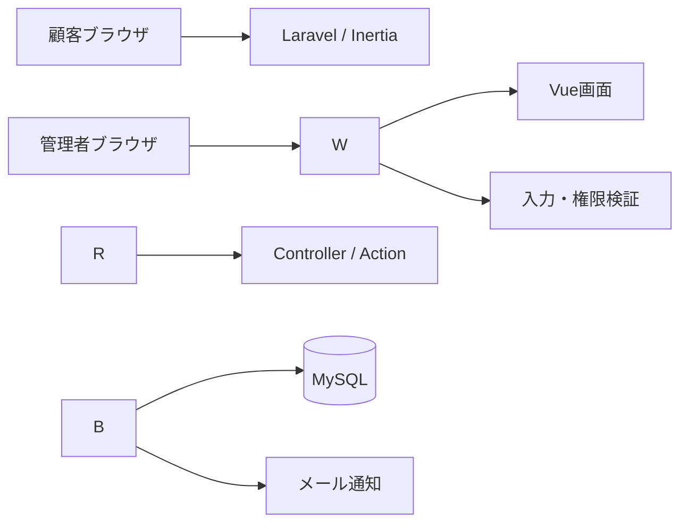
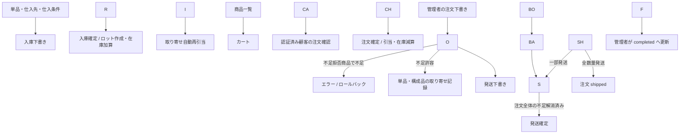
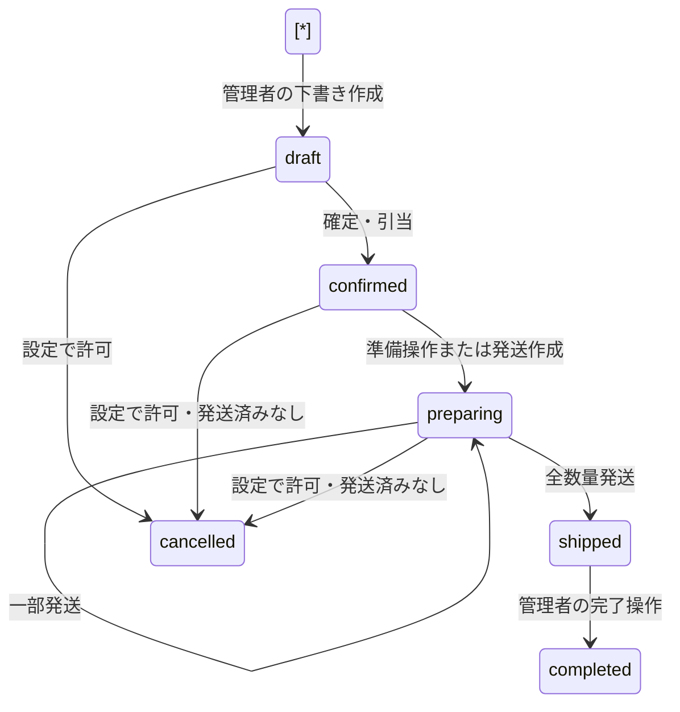

# ECPackage 基本設計書（仕様書）

* 文書版数：1.0
* 作成日：2026-10-23
* 対象：ECPackage（画面上の名称：EC02）
* 作成基準：作業ディレクトリの現行実装と接続中の開発DB
* 位置づけ：実装から整理した現状仕様。将来要件や承認済み業務仕様を意味しない。
* 関連文書：[DB設計書（テーブル定義書）](DB_DESIGN.md)

## 1\. 目的・範囲

顧客向けの商品閲覧・カート・注文受付と、管理者向けの商品、仕入先、仕入入庫、ロット在庫、受注、取り寄せ、発送を一つのアプリケーションで管理する。

本書は画面、認証・権限、入力条件、業務処理、状態遷移、データ更新タイミングを整理する。未実装機能や未確定事項は第12章に記載する。

|用語|意味|
|-|-|
|基本商品|共通属性定義を持つ商品グループ（product\_groups）|
|販売商品|SKUを持つ販売単位。単品またはセット商品（products）|
|商品分類|親子階層を持ち、販売商品に複数付与できるカテゴリ|
|セット商品|本登録済みの単品の組合せ。独立在庫ではなく構成品を引き当てる|
|ロット|入庫明細ごとの在庫単位。仕入先・期限・仕入単価を保持|
|引当|注文で使用するロット・数量を決定し、現在庫を減らす処理|
|取り寄せ|在庫不足を許容した注文の未引当数量。仕入発注書の生成ではない|
|発送|配送会社・追跡番号・発送数量の実績管理。引当済み在庫を再減算しない|

## 2\. システム構成

|項目|構成・確認内容|
|-|-|
|サーバー|composer.json要求：Laravel ^13.17、PHP ^8.3|
|実行環境|Laravel Sail。確認時のコンテナPHPは8.5.8。WSLホストPHP 8.1はアプリ要件を満たさない|
|フロントエンド|Vue 3、Inertia 2、Vite 8、Tailwind CSS 4（package.jsonの要求系列）|
|DB|接続ドライバmysql。compose.yamlはMySQL 8.4を定義|
|開発サービス|Redis、Mailpitの構成あり。本番採用や各ドライバの実利用とは区別する|
|通信|WebルートとInertia。独立した業務用外部REST APIは確認できない|
|ヘルスチェック|bootstrap/app.phpで /up を定義|

根拠：[composer.json](composer.json)、[package.json](package.json)、[compose.yaml](compose.yaml)、[bootstrap/app.php](bootstrap/app.php)。

## 3\. 利用者・権限

|操作|未ログイン|メール未確認会員|認証済み顧客|認証済み管理者|
|-|-|-|-|-|
|ホーム・商品一覧・カート|可|可|可|可|
|登録・ログイン・再設定|可|guestルート利用不可|guestルート利用不可|guestルート利用不可|
|メール確認・再送・ログアウト|不可|可|可|可|
|チェックアウト|不可|認証案内へ|可|403|
|顧客用注文一覧・詳細|不可|認証案内へ|本人分のみ|403|
|管理機能|不可|利用不可|不可|可|

管理機能はauth、can:access-admin、verifiedを共通適用し、role=adminを確認する。一般登録はrole指定を禁止し、DB既定値customerを使用する。管理者のアカウント作成ではcustomer/adminを指定できる。他人の注文詳細は404。管理者ログインは認証条件にrole=adminを追加し、通常ログインでも管理者は管理画面へ遷移する。

根拠：[ルート](routes/web.php)、[認可定義](app/Providers/AppServiceProvider.php)、[顧客注文制御](app/Http/Controllers/Shop/CustomerOrderController.php)。

## 4\. 画面・エンドポイント

### 4.1 顧客・共通画面

|ID|画面|GETパス|主な操作・表示|
|-|-|-|-|
|C01|ホーム|/|商品一覧、会員登録、ログイン、管理画面への導線|
|C02|商品一覧|/shop|商品名・SKU、分類、在庫有無の検索、価格・在庫・セット構成、カート追加|
|C03|カート|/cart|単価・数量・金額・合計、数量変更、削除|
|C04|注文確認|/checkout|最新価格の明細、合計、備考、注文確定|
|C05|注文履歴|/orders|本人の注文一覧・状態・金額|
|C06|注文詳細|/orders/{order}|注文、セット構成、取り寄せ、発送済み伝票|
|A01|ログイン|/login、/admin/login|メール・パスワード・ログイン保持|
|A02|会員登録|/register|名前・メール・パスワード・確認入力|
|A03|再設定依頼|/forgot-password|再設定リンク送信|
|A04|パスワード再設定|/reset-password/{token}|トークン・メール・新パスワード|
|A05|メール認証案内|/email/verify|確認メール再送|

商品一覧は12件/ページ、顧客注文一覧は20件/ページ。商品詳細専用ルートはない。公開商品検索の分類指定は直接所属で判定し、管理側のような子孫分類展開は行わない。

### 4.2 管理画面

以下のパスはすべて /admin 配下。作成・編集では同一Vueフォームを共用する場合がある。

|ID|画面|パス|主な操作・表示|
|-|-|-|-|
|M01|ダッシュボード|/|アカウント一覧・件数（15件/ページ）|
|M02|アカウント作成|/users/create|顧客・管理者作成、確認メール|
|M03|商品分類|/categories、/categories/create、/categories/{category}/edit|階層・表示順・有効/無効|
|M04|基本商品|/product-groups、/product-groups/create、/product-groups/{product\_group}/edit|名称・説明・属性定義|
|M05|販売商品|/products、/products/create、/products/{product}/edit|SKU・単位・登録/公開状態・価格・分類・属性・セット|
|M06|仕入先|/suppliers、/suppliers/create、/suppliers/{supplier}/edit|連絡先・取扱商品・仕入条件|
|M07|仕入入庫|/purchase-receipts、/purchase-receipts/create、/purchase-receipts/{purchase\_receipt}/edit|下書き・入庫確定|
|M08|ロット在庫|/inventory-lots|在庫検索、単位別数量集計|
|M09|出庫・在庫調整|/stock-operations、/stock-operations/create、/stock-operations/{stock\_operation}|手動出庫・調整、履歴|
|M10|注文管理|/orders、/orders/create、/orders/{order}/edit|代理受注、確定、引当、状態変更、取消|
|M11|取り寄せ管理|/backorders|未引当・完了・取消検索、再引当|
|M12|発送管理|/shipments、/shipments/create、/shipments/{shipment}/edit|下書き・分割発送・確定・取消|
|M13|注文設定|/order-settings|キャンセル可能状態の選択|

分類はツリー、基本商品は全件一覧。それ以外の業務一覧は20件/ページ。手動在庫操作のロット候補は新しい入庫日・ID順の最大500件。

### 4.3 更新・認証ルート

|対象|メソッド・パス|処理|
|-|-|-|
|カート|POST /cart、PATCH /cart/{product}、DELETE /cart/{product}|追加・数量置換・削除|
|購入|POST /checkout|顧客注文作成・確定|
|アカウント|POST /register、POST /admin/users|一般登録・管理者作成|
|ログイン|POST /login、POST /admin/login|セッション認証|
|ログアウト|POST /logout|セッション破棄|
|パスワード|POST /forgot-password、POST /reset-password|再設定依頼・更新|
|メール確認|GET /email/verify/{id}/{hash}、POST /email/verification-notification|署名付き認証・再送|
|分類・基本商品・販売商品・仕入先・入庫・注文・発送|POST /admin/{対象}、PUTまたはPATCH /admin/{対象}/{id}|作成・更新。実パスは4.2参照|
|在庫操作|POST /admin/stock-operations|即時記帳|
|注文状態|PATCH /admin/orders/{order}/status|準備中・完了へ。shipped直接指定は業務処理で拒否|
|注文取消|POST /admin/orders/{order}/cancel|理由付き取消|
|再引当|POST /admin/backorders/allocate|未引当商品の一括処理|
|発送取消|POST /admin/shipments/{shipment}/cancel|下書き取消|
|注文設定|PUT /admin/order-settings|取消可能状態保存|

管理マスタ・伝票の削除ルートはない。下書き明細編集や関連情報同期では内部的に削除・無効化する。
根拠：[routes/web.php](routes/web.php)、[画面](resources/js/Pages)。

## 5\. 業務フロー

カート投入では在庫を確保しない。受注確定・再引当でinventory\_lots.current\_quantityを減らす。この値は未発送の引当済み数量を除くため、倉庫の物理的な実在庫数とは区別する。

## 6\. 機能別仕様

### 6.1 認証・アカウント

* 名前必須100文字、メール必須255文字・一意。メールは小文字化・前後空白除去。
* パスワード12～72文字、英字・数字を含み確認入力と一致。Userモデルのhashedキャストで保存。
* 登録後はログインしセッションID再生成、認証案内へ遷移。管理者作成時も確認メール送信。
* ログイン成功時もセッションID再生成。ログアウトはセッション無効化・CSRFトークン再生成。
* 再設定依頼はメール登録有無によらず同じ案内を返す。変更時はremember\_tokenを更新し、当該ユーザーのDBセッションを削除する。
* config/auth.phpで再設定トークン有効期間60分、再発行間隔60秒を定義。

### 6.2 分類・基本商品・属性

* 分類：名称100文字、表示順0～999999、有効/無効、任意の親。自身・子孫を親とする循環は禁止。
* 親が無効なら配下も管理側の商品新規関連付けでは無効扱い。既存関連は保持可能。
* 基本商品：名称150文字、説明2000文字、属性最大20件。
* 属性：コード50文字（英小文字開始、英小文字・数字・アンダースコア）、名称80文字、text/number/select、必須フラグ、状態、表示順。
* selectの選択肢は1～50件、各100文字、重複不可。使用中の属性型変更・使用中選択肢の削除は禁止。除外された属性は無効化。
* 属性値は255文字以内の文字列。numberは符号付き整数15桁・小数6桁以内を検証。本登録時は有効な必須属性を検査する。

### 6.3 販売商品・セット

* 名称200文字、SKU50文字、単位、登録状態、公開状態、不足方針、標準販売単価を保持。
* SKUは英大文字化し英数字・ハイフン・アンダースコアを許可。省略時はP-＋ULID。
* provisionalはprivateのみ。confirmedには単価が必要。本登録から仮登録への差戻し、本登録後の種類・単位変更は禁止。
* 公開購入対象は本登録・公開・単価設定済み。管理者受注では非公開の本登録商品も選択可能。
* 分類最大100件。属性は選択した基本商品の有効な定義に限定。
* singleに構成品は設定不可。bundleは本登録時1～100件の構成品が必要。自身・セット商品・仮登録商品・構成品重複は禁止。
* セットの販売単位は整数単位。構成数量は構成品の単位精度に従う。
* 販売可能セット数＝各構成品在庫÷構成数量の最小値を整数切捨て。
* 受注確定時に構成品のSKU・名称・単位・構成数量・必要数量を保存し、その後のマスタ変更と切り離す。

### 6.4 仕入先・仕入条件

* 仕入先名150文字、コード50文字、担当者100文字、メール255文字、電話50文字、郵便番号20文字、住所500文字、備考2000文字。
* コードは英大文字化・一意。省略時S-＋ULID。状態active/inactive。
* 商品別条件は最大100件。仮登録または本登録の単品のみ、同一商品重複不可。
* 基準仕入単価、最小発注数量、標準納期0～3650日、仕入先商品コード、通常仕入先フラグを保持。
* 通常仕入先設定時は同一商品の他仕入先のフラグを解除。無効な仕入条件は通常仕入先にできない。
* 除外した条件は削除せず無効化。仕入先無効化時は通常フラグを解除する。

### 6.5 仕入入庫

* 伝票番号R-＋ULID。仕入先・入庫日・備考・1～100明細を入力しdraft保存またはposted確定。
* 明細：商品、仕入条件、ロット番号、製造日、期限日、数量、単価。仕入先・商品・有効な仕入条件の対応を検証。
* 同一伝票内の同一商品＋ロット番号重複不可。ロット番号はDB全体の一意キーではない。
* 期限日は製造日以降。数量は正、単価は0以上。金額＝数量×単価、小数4桁。
* 確定時に1明細から1ロット作成。初期数量＝現在数量＝入庫数量。stock\_movementsにinbound記録。
* 同じ入庫明細の再反映を拒否。確定後編集不可。同一トランザクションで対象商品の取り寄せ自動再引当を実行。

### 6.6 在庫・手動出庫・調整

* 在庫一覧：商品名/SKU/ロット番号、商品、仕入先、入庫月、在庫有無で検索。数量は単位別集計。
* 手動出庫は正の入力を負の増減へ変換。調整は符号付き増減量を入力し、棚卸後残数の直接指定ではない。
* 操作は1～100明細、同一ロット重複不可。処理後在庫が負なら全体をロールバック。
* 操作番号SO-＋ULID。処理前・増減・処理後数量と原価を明細に記録し、在庫移動履歴を保存。
* 残量0はdepleted、正ならactive。手動増加調整後の自動再引当はなく、取り寄せ画面の再引当を使用。

### 6.7 カート・顧客購入

* カートはセッションのproduct\_id→数量で保持。専用テーブルなし。同一商品追加は加算、数量変更は置換。
* reject商品は在庫超過を拒否。backorder商品は超過を許容。
* 注文確認にはログイン・メール認証・顧客権限が必要。空カートはカート画面へ戻す。
* 注文時に公開条件、最新価格、数量精度、在庫を再検査。クライアントの単価・合計を信用して保存しない。
* 成功後カートを消去し注文詳細へ遷移。備考は任意2000文字。

### 6.8 受注・引当

* 注文番号O-＋ULID。管理者作成はorder\_source=admin、顧客購入はcustomer。
* 管理者は顧客、注文日、1～100商品、数量、単価、備考を指定。同一販売商品は1行にまとめる。
* 管理者はdraft保存可能。顧客は同一トランザクションで注文作成・確定。
* 明細に商品名・SKU・単位名・単価・数量・金額を保存。現状subtotal=total=明細金額合計。
* ロット引当順は期限あり優先→期限昇順→入庫日昇順→ID昇順。正の残量が対象。期限切れを除外する条件はない。
* 単品は注文数量、セットはセット数×構成数量を引当。ロット・数量・原価・在庫操作明細の対応を保存。
* 不足時は販売商品側のshortage\_policyに従う。rejectは拒否、backorderは可能分を引き当て不足をorder\_backordersへ保存。
* 全量取り寄せではstock\_operation\_idがNULLでもconfirmedとなる。
* 確定済み注文の顧客・明細・単価等は編集不可。状態変更・取消は専用操作。

### 6.9 取り寄せ・通知

* 再引当対象は残数量>0かつconfirmed/preparingの注文。注文日、注文ID、明細番号順に処理。
* ロット順は通常引当と同じ。残数量更新、backorder\_allocation在庫操作、追加引当実績を作成。
* 同一注文明細・同一ロットへの複数引当を許容。
* 解消時fulfilled\_atを保存。単品はorder\_linesの互換用欠品項目も更新。セット不足は構成品単位。
* 全不足解消かつ未通知ならbackorder\_completed\_atを保存し、コミット後にメール送信。
* BackorderReadyはmail通知。ShouldQueue未実装のため非同期実行を前提としない。

### 6.10 キャンセル

* 管理者のみ。理由必須500文字。許可状態は設定から取得。
* 設定可能値draft/confirmed/preparing、初期は全3値。空配列なら取消不可。
* 発送済み伝票がある注文や取消済み注文は拒否。
* 全引当を元のロットへcancellation\_returnとして返却し、引当実績は履歴として保持。
* 未引当残を0にし、発送下書きも取消。取消者・日時・理由・戻入操作IDを保存。

### 6.11 発送

* 伝票番号S-＋ULID。confirmed/preparingの注文が対象。伝票作成で注文をpreparingへ進める。
* 1注文に複数伝票・分割発送可能。1伝票1～100明細、同一注文明細重複不可。
* 数量上限＝注文数量－他の取消以外の発送伝票数量。他の下書きも予約数量に含め保存時再検査。
* 確定には配送会社・発送日が必要、追跡番号は任意。注文全体の取り寄せ残がある間は一部商品の発送も確定不可。
* 全数量発送で注文shipped、それ以外はpreparing。発送確定で在庫を再減算しない。
* 確定・取消後の編集、保存後の注文差替えは禁止。取消は下書きのみ。発送済み取消・返品は未実装。

根拠：[管理コントローラ](app/Http/Controllers/Admin)、[顧客コントローラ](app/Http/Controllers/Shop)、[業務Action](app/Actions)、[入力検証](app/Http/Requests)。

## 7\. 状態遷移

顧客購入も内部ではdraft→confirmedを通るが、顧客の下書き保存画面はない。

|対象|遷移|
|-|-|
|商品登録|provisional→confirmed、逆不可|
|商品公開|本登録商品のprivate/public切替。仮登録はprivateのみ|
|入庫|draft→posted、確定後編集不可|
|発送|draft→shipped または cancelled、逆不可|
|ロット|数量に応じactive/depleted|
|取り寄せ|status列なし。残数量、fulfilled\_at、親注文取消状態で判定|

## 8\. 共通入力・データ・排他制御

|項目|仕様|
|-|-|
|数量・金額|主にDECIMAL(19,4)。入力上限999999999999999.9999。数量は単位精度も検証|
|初期単位|piece（個）・set（セット）は小数0桁、kg・mは小数3桁。UnitSeederによる|
|計算・表示|主な確定計算はBCMath小数4桁。画面は日本語数値表示・最大小数4桁、円表記あり|
|日付|注文・入庫・在庫処理はY-m-d。発送関連はdate検証|
|備考|通常2000文字。在庫移動履歴のnotesはDB500文字（第12章）|
|楽観ロック|分類・基本商品・商品・仕入先・入庫・注文・発送の編集時にlock\_version照合|
|悲観ロック|在庫・確定・取消にlockForUpdateとトランザクション。主な処理は最大3回試行を指定|
|履歴|在庫操作・移動・引当・確定取消者を記録。全変更監査ログではない|
|状態変更・取消|現在のDB状態を再確認。全操作がクライアントlock\_versionを要求するわけではない|

## 9\. エラー・セキュリティ・頻度制限

入力不正・在庫不足・競合はフィールド単位のValidationExceptionとしInertiaフォームに表示する。未ログイン時は通常/admin別のログインへ、メール未確認は認証案内へ誘導する。権限違反403、他人の注文や対象なし404。webミドルウェアによるセッション・CSRF保護を使用する。

|操作|制限|
|-|-|
|ログイン|IPごと30回/分、メール＋IPごと5回/分|
|登録・再設定依頼/実行・メール確認/再送|各ルート6回/分|
|注文購入・管理者アカウント作成|各ルート10回/分|

根拠：[AppServiceProvider](app/Providers/AppServiceProvider.php)、[routes/web.php](routes/web.php)、[bootstrap/app.php](bootstrap/app.php)。

## 10\. 外部連携・運用

|項目|現状|
|-|-|
|メール|登録認証、再設定、取り寄せ完了。開発構成にMailpit|
|配送会社|名称・追跡番号を手入力。API・ラベル発行なし|
|決済|決済プロバイダ・支払状態・決済取引の実装を確認できない|
|定期処理|routes/console.phpに業務スケジュールなし。再引当は入庫確定または手動|
|本番運用|配置先・バックアップ/復旧・監視・保存期間・可用性目標は要確認|
|機密情報|.envの秘密値や個人データを文書に含めない|

## 11\. 根拠・検証範囲

ルート、Controller、FormRequest、Action、Model、主要Vue画面、15件のマイグレーションを参照。Sail実行環境とBoost導入済み状態を確認し、migrate:statusで15件すべて適用済みを確認した。DB設計書は開発MySQLの構造情報を読み取り、後続マイグレーションの変更点と照合した。業務データは更新していない。

文書追加のみのためアプリケーションテスト・ブラウザ操作試験は実施していない。本書は試験合格や性能を保証するものではない。

既存テスト参照：[認証](tests/Feature/AuthenticationTest.php)、[顧客購入](tests/Feature/CustomerShoppingTest.php)、[セット](tests/Feature/BundleProductTest.php)、[受注](tests/Feature/OrderManagementTest.php)、[受注状態](tests/Feature/OrderLifecycleTest.php)、[入庫](tests/Feature/PurchaseReceiptManagementTest.php)、[在庫操作](tests/Feature/StockOperationManagementTest.php)、[発送](tests/Feature/ShipmentManagementTest.php)。

## 12\. 未実装・要確認事項

|ID|項目|現状と確認事項|
|-|-|-|
|Q01|決済・税・送料・割引|subtotal=total。税率・端数・送料・割引・支払要件の定義が必要|
|Q02|配送先|顧客住所・配送先スナップショット・配送方法の業務テーブル/購入入力なし|
|Q03|返品・返金|発送済み取消・返品・返金は未実装|
|Q04|期限切れ|期限順引当だが期限切れを除外しない。販売可否の要件確認が必要|
|Q05|共通構成品の引当|複数セットや単品との構成品共有時、候補計算後にまとめて在庫更新する。累積必要量を踏まえた配分・取り寄せは追加検証が必要|
|Q06|在庫調整の長文備考|操作備考2000文字、理由未指定時の転記先stock\_movements.notesは500文字。長文時の扱いを要確認|
|Q07|通知失敗|完了記録後に通知。失敗時の再送キュー・運用を要確認|
|Q08|分類検索差異|顧客は直接分類、管理者は子孫含む。階層無効状態も含め公開側の期待仕様を確認|
|Q09|二重送信・同時実行|ロック・状態検査はあるがチェックアウト専用冪等キーなし。並行購入の受入試験が必要|
|Q10|表示精度|UIにJavaScript Number変換あり。大きな値の表示精度・通貨端数の要件確認が必要|
|Q11|非機能|件数・応答時間・同時接続・対応ブラウザ・バックアップ・RPO/RTO・タイムゾーン未確定|
|Q12|将来用項目|products.attributes、merged\_into\_idは存在。現行属性編集は別テーブル、商品統合フローなし|

## 13\. 改訂履歴

|版|日付|内容|
|-|-|-|
|1.0|2026-10-23|現行実装と開発DBを基に初版作成|

